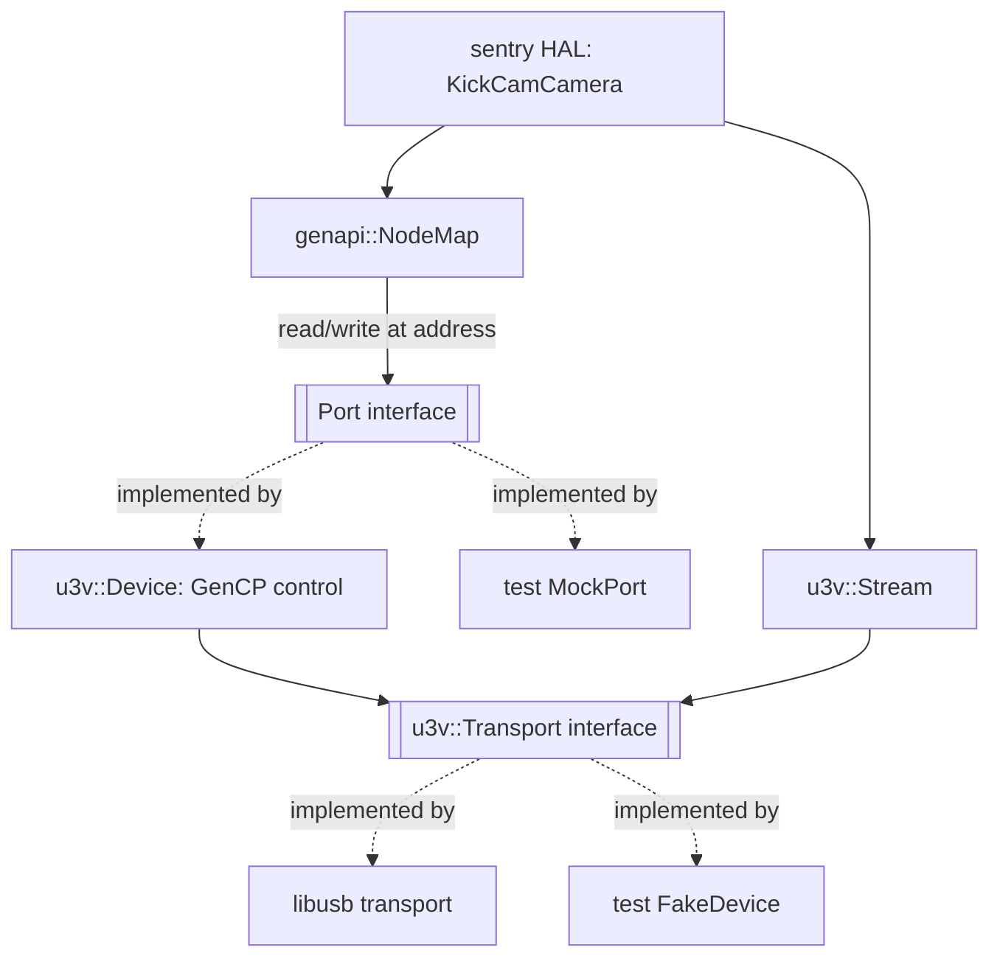

# KickCam plan

KickCam is a lean C++ library to configure and stream from GenICam cameras. It reads the camera's
GenICam XML to find its features, like aravis does, but with no glib and frames written straight
into buffers the caller owns.

The goal is every GenICam transport: USB3 Vision, GigE Vision, and the frame grabber standards
(CoaXPress, Camera Link) through GenTL. We get there one transport at a time. The first milestone,
v1, is USB3 Vision with a GenApi subset.

First user: sentry's camera HAL, to replace `AravisCamera` on marvin_f90c (Hikrobot MV-CB060 ego
camera, two MV-CB013 wrist cameras, on a Jetson).

## Scope

### In v1

- USB3 Vision devices only: discovery, control (GenCP), streaming.
- A GenApi subset: enough node types to read and write any standard feature on the cameras we
  run. An XML that uses a node type outside the subset fails to load, with the node type and name
  in the error.
- Caller-owned frame buffers, per-frame status, block id, device timestamp, host timestamp.
- Two command-line tools: `kickcam_dump` (list devices, dump features) and `kickcam_grab`
  (stream, report fps, drops and errors).
- A fake U3V device for tests, with fault injection.
- A Python wheel (nanobind), built with uv locally and cibuildwheel in CI. Its API (list devices,
  read features, grab into numpy) is scoped after phase 3.
- Linux (x86_64, aarch64) and macOS.

### After v1

In this order (see Roadmap after v1):

1. GigE Vision.
2. Full GenApi: caching, invalidators, polling, every node type.
3. Chunk data and events, on both transports.
4. A GenTL consumer, for CoaXPress and Camera Link cameras behind a frame grabber.

### Not planned

- A GenTL producer (a `.cti` that exposes KickCam to third-party software).
- Windows for USB3 Vision: libusb needs the WinUSB driver bound to each camera by hand. GigE
  Vision only needs sockets, so Windows can come with it.
- Claiming GenICam compliance before full GenApi. The name GenICam is an EMVA trademark; until
  then the README says "reads GenICam XML", nothing more.

## Architecture



One library, `kickcam`, in two parts:

- `kickcam::genapi` (`include/kickcam/genapi`, `src/genapi`): XML to node map over an abstract
  `Port`. No USB code. Tested with a mock port against XML files.
- `kickcam::u3v` (`include/kickcam/u3v`, `src/u3v`): discovery, GenCP control (implements
  `Port`), the XML from the device manifest, streaming. It talks to USB through a small
  `Transport` interface, so the fake device plugs in below it.

`genapi` never includes from `u3v`.

Rules that keep GigE Vision and GenTL from forcing a rewrite:

- `Frame`, `DeviceInfo` and the buffer model live in `kickcam::`, not in `kickcam::u3v`. Every
  transport fills the same `Frame` and takes the same caller-owned buffers.
- `u3v::Stream` has the shape every later stream follows: queue a buffer, wait for a frame,
  start, stop. A common `kickcam::Stream` interface is extracted when the second transport lands,
  not before.
- `genapi` reads and writes only through `Port`. Every node read goes through one path, so the
  cache that full GenApi needs (GigE register access costs a network round trip) has one place
  to go.
- The XML location is parsed from the GenICam URL form (`Local:<file>;<address>;<length>`),
  which U3V manifests and GigE Vision URL registers share.

### API sketch

```cpp
namespace kickcam::u3v
{
    std::vector<DeviceInfo> list_devices();               // vendor, model, serial, bus path

    class Device
    {
    public:
        Device(Transport& transport);
        Port& port();                                     // GenCP READMEM / WRITEMEM
        std::string xml();                                // from the manifest, unzipped
    };

    class Stream
    {
    public:
        Stream(Device& device, std::size_t payload_size);  // programs SIRM
        void start();                                      // enable SIRM, then AcquisitionStart
        void stop();
        void queue(std::span<uint8_t> buffer);             // caller-owned, stays valid until returned
        std::error_code wait(Frame& frame, nanoseconds timeout);
    };
}

namespace kickcam::genapi
{
    class NodeMap
    {
    public:
        NodeMap(std::string_view xml, Port& port);
        Node& node(std::string_view name);                // Integer, Float, Enumeration, ...
    };
}
```

`Frame` holds the buffer span, the valid size, a status (complete, incomplete, too large), the
block id and pixel format from the leader, the device timestamp in ns, and the host time when the
trailer arrived.

## Dependencies

| Dependency | Why | License |
|---|---|---|
| libusb-1.0 | USB access on Linux and macOS | LGPL-2.1, linked dynamically, in the wheels too (auditwheel and delocate bundle the shared library, which users can replace) |
| pugixml | XML parsing | MIT |
| zlib | inflate the zipped XML; a short single-entry zip reader sits on top | zlib |
| GoogleTest | unit tests | BSD-3 |
| nanobind, scikit-build-core | Python wheel | BSD-3, Apache-2.0 |

The C++ dependencies come from conan-center.

## References

- USB3 Vision standard (A3, free after registration).
- GenCP, GenApi and SFNC standards (EMVA, free download).
- aravis sources, to understand behaviour and known camera quirks. Read only: aravis is LGPL,
  KickCam is CeCILL-C, so no code is copied.

## Phases

Each phase ends with its tests green in CI.

### 0. Skeleton (done)

Build and tooling copied from kickmsg: `scripts/configure.sh` and `scripts/setup_build.sh`
(Conan + CMake), the Conan recipe in `conan/all`, the version header generated from git, the
Python wheel (scikit-build-core, nanobind, uv), CI on `master` (Linux and macOS tests, aarch64
cross-build, `conan create`, wheels, PyPI release on tag), CeCILL-C license, `AGENTS.md`,
`uncrustify.cfg`.

`kickcam` is an INTERFACE target that carries only `kickcam/version.h`. It becomes a static
library with the first sources in phase 1, which also adds the header install rule and the
recipe's `libs`.

```
KickCam/
  include/kickcam/{genapi, u3v}
  src/{genapi, u3v}
  tests/unit
  tools/{kickcam_dump, kickcam_grab}
  py_bindings/        nanobind module kickcam._native
  python/kickcam/     pure-Python package
  docs/
```

### 1. GenApi subset (1-2 weeks)

- `Port` interface: `read(address, span)`, `write(address, span)`.
- Node types:
  - Values: `Integer`, `Float`, `Boolean`, `Command`, `String`, `Enumeration` and `EnumEntry`.
  - Registers: `IntReg`, `MaskedIntReg`, `FloatReg`, `StringReg`, `StructReg` and `StructEntry`,
    with `Endianess`, `Sign`, `pAddress` and `pIndex`.
  - Computed: `Converter`, `IntConverter`, `SwissKnife`, `IntSwissKnife`.
  - Navigation: `Category`, `Port`.
- Indirections: `pValue`, `pMin`, `pMax`, `pInc`, `pIsAvailable`, `pIsImplemented`, `pIsLocked`,
  `pSelected`.
- Formula evaluator for SwissKnife and Converter: integer and float arithmetic, bitwise and logic
  operators, comparisons, the `?:` operator, the standard functions (`ABS`, `SQRT`, `TRUNC`, ...),
  `PI` and `E`.
- No cache: every read goes to the port. Feature access happens at setup, not per frame.
- Tests: formula evaluator on its own; node maps from small synthetic XMLs over a mock port,
  one per node type and indirection.

### 2. Fake device and U3V control (1 week)

- `Transport` interface: synchronous bulk out/in for control, asynchronous bulk in for the stream.
- `FakeDevice`: a register map, GenCP over the fake control endpoint, the manifest and a zipped
  XML. Fault injection: `PENDING_ACK`, wrong request id, short answers, timeouts.
- libusb transport: find U3V devices (interface class 0xEF, subclass 0x05; protocol 0 control,
  2 streaming), claim the interfaces, clear halts on open.
- GenCP: `READMEM` / `WRITEMEM` with request ids, `PENDING_ACK`, transfers split to the size
  limits read from SBRM.
- ABRM and SBRM: identity, serial, manifest table, timestamp increment.
- `kickcam_dump` works on the real cameras.

### 3. U3V streaming (1-2 weeks)

- Program SIRM from the payload size, leader and trailer sizes and the endpoint's max packet
  size: payload transfer size and count, final transfer 1 and 2.
- Keep the caller's buffers queued as libusb asynchronous transfers. Parse the leader (`U3VL`)
  and trailer (`U3VT`). Report a frame as incomplete or too large rather than dropping it
  silently.
- Recovery: resync on a leader or trailer out of order, clear halt after a stall, report an
  unplug as an error from `wait`.
- `FakeDevice` streams frames with injected faults: short transfer, missing trailer, oversized
  payload, stall.
- `kickcam_grab` streams from one or several cameras and reports fps, drops and errors.

### 4. Bench validation (1 week, overlaps phase 5)

- XML check: load the XML of every camera we have (Hikrobot MV-CB060 and MV-CB013, plus any
  other vendor at hand) and read every feature without error.
- marvin_f90c rig: ego at 3072x2048 and two wrists at 30 fps, running for 24 h, no lost frames
  under steady load.
- Unplug and replug while streaming: the stream reports the error, and reopening works.

### 5. sentry integration (1 week)

- `KickCamCamera` in sentry-core's camera HAL, replacing `AravisCamera` with the same config
  keys.
- Frames written directly into the outgoing buffers, which removes the `memcpy` in today's grab
  path.
- Once marvin_f90c runs on KickCam, delete `AravisCamera` and the aravis dependency.

Total: 4 to 6 weeks for one person.

## Roadmap after v1

Rough sizes, one person, to be refined when v1 is done.

### 6. GigE Vision (4-8 weeks)

- Module `kickcam::gev` (`include/kickcam/gev`, `src/gev`), over plain UDP sockets.
- GVCP: discovery by broadcast, ForceIP, `READREG` / `WRITEREG` / `READMEM` / `WRITEMEM`,
  `PENDING_ACK`, control privilege and heartbeat. Implements `Port`.
- XML from the first URL register: `Local:` on the device, `File:` and `http:` on request.
- GVSP: leader, payload and trailer packets, 16-bit and extended 64-bit block ids, out-of-order
  packets, packet resend requests, stream channel setup (destination, packet size test for jumbo
  frames), multicast.
- Socket path: large receive buffers and `recvmmsg` first. `TPACKET_V3` or AF_XDP only if a
  10 GigE camera needs it, reusing what KickCAT learned on raw sockets.
- PTP device timestamps and action commands, to trigger several cameras at the same instant.
- Fake device over loopback UDP, with packet loss, reordering and duplicates injected.

### 7. Full GenApi (1-2 months)

- Every node type of the standard, caching modes, invalidators, polling, access modes.
- Checked against the private XML collection from every vendor we can get.
- From here the README may claim GenICam compliance.

### 8. Chunk data and events

- Chunk data parsed from the U3V trailer and the GVSP trailer, exposed through the node map like
  any feature.
- Events from the U3V event endpoint and the GigE Vision message channel.

### 9. GenTL consumer (2-3 weeks)

- Load a vendor's GenTL producer (`.cti`) and drive its interfaces, devices and data streams,
  for CoaXPress and Camera Link cameras behind a frame grabber.
- The producer supplies the `Port` and the stream, so `genapi` and `Frame` do not change.

## Risks

- **Stream sizing.** Wrong SIRM transfer sizes fail on some cameras and hosts only. Check them on
  the Jetson early, in phase 3, not at the end.
- **usbfs memory.** Linux limits the memory of in-flight USB transfers (`usbfs_memory_mb`, 16 MB
  by default). Three cameras with four 6 MB buffers each go over it. The robot image must raise
  it; `kickcam_grab` prints a clear error when the limit is hit.
- **Vendor XML licensing.** Vendor XMLs may be copyrighted, so they stay out of this public repo.
  Tests use synthetic XMLs that reproduce the patterns found in real files. The full check against
  real XMLs runs locally or from a private location.
- **GenApi long tail.** A new camera may use a node type or construct outside the subset. The
  loader fails loudly, and the fix is to add that construct with a test. Full GenApi (phase 7)
  ends this risk only as far as the XML collection reaches.
- **GigE Vision packet rates.** A 10 GigE camera sends about a million packets per second. Plain
  sockets may not keep up on a Jetson; the socket path is measured first, in phase 6.

## Open questions

- C++ standard: the skeleton uses C++20 like kickmsg. Move to C++23 like sentry, which would
  allow `std::expected`?
- Error model: `std::error_code` on the frame path is settled. Should setup (open, feature
  access) throw, like KickCAT, or also return errors?
- Where the private collection of vendor XMLs lives.
